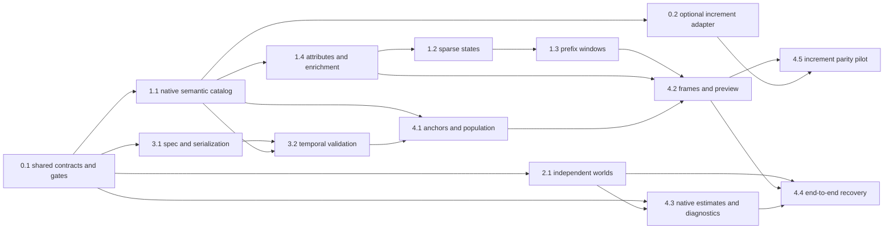

# terrine Build Implementation Plan

> **For agentic workers:** REQUIRED SUB-SKILL: Use superpowers:subagent-driven-development or superpowers:executing-plans to implement this plan task-by-task. Steps use checkbox (`- [ ]`) syntax. This is a planning deliverable, not authorization to implement or release.

**Goal:** Let data scientists, data engineers and AI agents safely create reproducible analytical and ML datasets from existing tables/semantic definitions, with explicit anchors, pre-treatment covariates and post-treatment outcomes.

**Architecture:** Standalone Python distribution with its own minimal typed Catalog, loader and coded errors. Native definitions and optional semantic adapters produce one normalized descriptor layer; the temporal engine compiles that layer into lazy Ibis frames. Dataset staging, descriptive reporting and orchestration reuse the same compiler. Increment is optional compatibility, never a core dependency or an editable prerequisite.

**Tech Stack:** Python `>=3.13,<3.15` target (verify supported versions), uv, hatchling/hatch-vcs, Ibis, Pydantic 2, PyYAML, SQLGlot, Arrow and NumPy; DuckDB reference backend. Increment, dataframe conversions, warehouse drivers and heavier methods are isolated extras. Ruff, ty, tach, Vulture, pydoclint, complexipy, prek; pytest/Hypothesis with focused xdist-safe tests.

**Spec:** [Original handoff](../specs/2026-10-16-terrine-handoff.md) is historical reference, not an approved specification. Latest user instructions supersede its monorepo/extraction assumption and the earlier mandatory increment dependency: no increment edits, independently usable terrine, compatible common stacks, scalable ML staging and incremental materialization. Deliver a reviewed detailed near-term plan plus complete roadmap, not product implementation in this session.

**Current scope:** [Datasets-only scope decision](../specs/2026-10-18-terrine-scope-datasets-only.md) supersedes estimation, inference, causal diagnostics, and effect-truth work below. Treat those roadmap sections as withdrawn; retain only dataset, export, descriptive-report and risk-set work.

## Global constraints

- Preserve product analytics framing; no marketing/channel-attribution examples. Never implement synthetic control, augmented synthetic control, SynthDiD or related methods.
- No release before increment's public launch. Packaging, local wheels and private benchmarks are allowed; publishing requires explicit authorization.
- Borrow only generic contributor guidance from increment. Do not transplant experiment-specific architecture, make targets before they exist, or its entire tooling infrastructure.
- Never edit, reorganize, patch, vendor wholesale or release increment. Only optional `terrine/adapters/increment.py` may import `increment.semantics`; broader test-only imports remain in `tests/parity/`. Native core, errors, generator and dataset workflow must work with increment absent.
- Temporal engine consumes normalized descriptors, not experiment models. It never imports study specs, inferential diagnostics or simulation. Specs never import Ibis.
- Strict `[start,end)` event windows; exact timestamp time zero. No flooring event anchors. Catalog day boundaries are explicit UTC fixed offsets, compatible with increment's vocabulary; no unannounced DST semantics.
- Additive windows use sparse prefix lookups, never anchor × all events/window joins or hidden dense unit × day intermediates. Explicitly requested bounded panel output is different and must be costed. Prefix subtraction does not apply to min/max, distinct or quantiles.
- Preserve integer/decimal types and scale; no blanket float conversion. Missing/unobserved differs from observed zero, per column and per source.
- Declared source completeness is required. `max(event_timestamp)` is not evidence that earlier data is complete.
- Static temporal checks enforce declared measurement windows, not truth of source contracts or historical availability of retrospectively corrected data.
- Customer rows, derived data and warehouse state stay in the customer's execution environment. Explicit local exports or partitioned ML exports to customer-owned object storage are allowed; no data routed through hosted terrine services and no payload/secret logging. Warehouse-only derived tables remain the default; exported training artifacts are an explicit owner-requested extension.
- Terrine makes no causal claims and does not ship effect estimators. Treatment/cluster roles and grace-window metadata describe datasets; causal analysis is downstream.
- Focused checks only at coherent milestones. No network/warehouse in unit tests; live checks under `integration/warehouse_execution/`. Estimation/calibration work is withdrawn by the datasets-only scope.
- Apply [contributor API/test restraint](../../../AGENTS.md#tests-and-validation) across this master and every companion. Named test lists specify required behavior, not test-function quotas: consolidate where coverage stays traceable and update command selectors. Do not weaken numerical, temporal, serialization or cross-path contracts to shrink the suite.

## Review focus

1. Intraday equality boundaries, simultaneous events and strict pre-treatment attributes: Tasks 1.3/1.4 and 4.2 prove exclusion/inclusion; 4.1 tests anchor identity/time only.
2. Coverage starts late or differs across sources; inactivity must not masquerade as missing data: Tasks 1.1/1.3 and 4.2 prove null reasons and per-column completeness.
3. Event-free units and entry/exit dates: Task 4.1 preserves a declared roster and never invents it from activity.
4. Treatment classification, censoring and event cohorts are descriptive dataset semantics; do not gate them with causal assumptions.
5. Precision, SQL/source identity and cost claims: Tasks 0.2/1.2/4.2 exercise version compatibility, exact amounts, admitted SQL and unknown scan costs; never call output bytes a scan budget.

## Plan map and authoritative interfaces

| Document | Detailed tasks | Owns |
| --- | --- | --- |
| This master plan | 0.1, 0.2, 4.5 | Foundation, compatibility, integration evidence; full roadmap |
| [Temporal](2026-10-16-terrine-temporal.md) | 1.1–1.4 | Binding, readiness, sparse states/prefixes, attributes |
| [Study API](2026-10-16-terrine-study-api.md) | 3.1, 3.2, 4.1, 4.2 | Serializable expressions, validation, anchors/population, frames/preview |
| [Datasets-only scope](../specs/2026-10-18-terrine-scope-datasets-only.md) | — | Supersedes estimation, inference, causal-diagnostics and effect-truth roadmap sections |
| [Dataset workflows](2026-10-16-terrine-dataset-workflows.md) | 6.2; amendments to 7.1/7.2/12.1 | State panels, training/scoring conveniences, safe live run observations |

Shared pure metric rules/refusals belong to Task 1.1's `semantic/rules.py`, available before Task 3.2. Validation never imports temporal/compiler modules for error constants. Task 4.2 commits its execution verifier and all native facade/export changes together and verifies the committed tree, not leftover working files.

Concrete signatures belong to the owning companion, not duplicated variants in this master. When contracts change, update their consumers and issue dependency records before implementation. Farther phases get their own reviewed step-level plans when reached, not speculative implementation bodies now.

## Ground truth from increment

Inspected `/Users/kylejcaron/increment`, upstream main `064758e3ce79ef031413f4a040f40e5270fa36ad`. Do not treat a dirty local checkout or its installed version as an immutable published dependency.

| Evidence | Consequence |
| --- | --- |
| `increment/semantics/models.py:694–826`: Property, DimValidity, DimSource, FactSource | Optional adapter maps existing SCD2/changelog declarations into native Catalog; it does not force users to rewrite increment definitions |
| `models.py:1024–1029`: sum/count/count_distinct/avg_event/avg_calendar_day/min/max; ratio structural at 1427 | Bind declared aggregation and filters, distinguish event averages, unit means, ratios and report-only metrics |
| `models.py:2536` and `loader.py:184`: Definitions/load; exposure and experiment fields remain intertwined | Adapter projects only the required generic definitions; no extraction prerequisite |
| `query/builders.py:723`: sparse unit-day state, but `panel_spine` at 1013 is exposure-specific | Preserve useful semantic meaning via the adapter; never import private exposure-shaped builders |
| `query/dims.py:58` and `semantics/artifact.py:394` | Existing history normalization is useful precedent; artifact loaded-through metadata is not a generic source-readiness contract |
| `increment/errors.py:97,292` | Useful error-contract precedent, not a required import; terrine implements its own small immutable/pickle-safe coded-error contract |
| `pyproject.toml:23–45,78–100`, `tach.toml`, Makefile | Similar tooling is sensible; package/dependency compatibility must be tested, not assumed |

A read-only runtime probe constructed source/metric/SCD2 definitions in the existing environment: increment `0.1.0a3.dev39+g064758e3c.d20261014`, Ibis `12.0.0`. That confirms only those local APIs, not PyPI compatibility or terrine behavior. Optional Task 0.2 verifies supported adapter versions; native execution does not wait for it.

## Decisions and corrections to the handoff

| Topic | Decision and reason |
| --- | --- |
| Repository/extraction | Latest user instruction: independently usable native terrine; optional increment adapter. No increment code changes or extraction prerequisite. Public release timing remains the owner's separate gate. |
| Long-term dependency direction | Increment may be an optional dependency via its adapter. A future common engine or reverse integration needs separate evidence and authorization; never create a runtime cycle. Task 4.5 measures compatibility without modifying either package's semantics. |
| Primary user API | Named feature/outcome dictionaries of `agg`/`asof` expressions; explicit anchors and role metadata. Convenience macros must expand into this same AST, not a second compiler. |
| Unit universe | A once-configured roster for fixed/scheduled studies; event anchors may derive participants from their fact. No hidden exclusion of zero-activity units. |
| Time | Exact UTC-aware timestamps. Daily sparse prefixes only for day-aligned endpoints; arbitrary timestamp endpoints require an event-resolution prefix path with honest cost. Raw events therefore are not reserved for the later sequence phase. |
| Censoring/readiness | Complete half-open source intervals; per-column completeness/null reasons; ratios intersect both sources. No use of maximum event time as completeness. Unknown source history cannot support a `never treated` lifetime claim. |
| Attributes | Strict `before=` cutoff for features; reject ambiguous/overlapping SCD2 history. Effective-time correctness is not bitemporal knowledge-time correctness; disclose the distinction. |
| Precision | Preserve exact integer/decimal types and scale. Float64 aggregation uses the temporal plan's fixed `checked_float64_v1` certificate/tolerance and explicit cancellation refusal; no blanket decimal cast or silent fallback. Certificates survive exports and uncertainty-aware eligibility comparisons. |
| Grace-period treatment | Initiation-within-grace frames are descriptive until a valid landmark or clone-censor-weighting analysis is implemented. Delaying outcomes alone is insufficient. |
| Sampling | Nuisance-training subsampling and analysis-population sampling are separate modes. The handoff says both “sample controls” and “estimate on every row”; specify which population every row belongs to, inclusion probabilities, estimand and variance. |
| Diagnostics | Evidence/assumption checks, not proof of causal identification. Not every diagnostic applies to every estimator. Agent hard-fail policy must distinguish fail, warn, unavailable and not-applicable. |
| Runtime | Hash+watermark alone misses restatements; immutable source/table generations enter provenance. Plan-ID leases do not lock overlapping resources: use resource interval leases, renewal, fencing and publication recovery. |
| Backend promises | DuckDB first. Compile-only SQL is not executed warehouse support. Cost/atomicity/lease capabilities are explicit per backend. |
| Adapter acceptance | Compare to each library's equivalent estimator/estimand and supported uncertainty contract; a survival or LTV model should not be tested for equality to AIPW. |

## User workflow

Proposed, not implemented. `semantic.yaml` is terrine's small native Catalog declaring named sources, metrics and SCD2 dimensions; Task 1.1 specifies it. Existing increment users instead call `Model.from_increment("definitions/", ...)` with the optional adapter—the Design below is unchanged. Ambiguous property names require qualification.

```python
from pathlib import Path
import ibis
import terrine as tr
from terrine.spec import to_yaml

model = tr.Model.from_catalog(
    "semantic.yaml",
    con=ibis.duckdb.connect("product.duckdb"),
    readiness={
        "product_events": tr.Coverage(start="2025-01-01", through="2026-09-30"),
    },
)

design = tr.Design(
    unit="user",
    anchor=tr.EventAnchor("feature_enabled", which="first"),
    anchor_range=tr.AnchorRange(start="2025-03-01", end="2026-08-01"),
    features={
        "sessions_before": tr.agg("sessions", window=("-28d", "0d")),
        "revenue_before": tr.agg("revenue", window=("-28d", "0d")),
        "plan_before": tr.asof("plan_tier", before="0d"),
    },
    outcomes={
        "sessions_after": tr.agg("sessions", window=("0d", "28d")),
        "revenue_after": tr.agg("revenue", window=("0d", "56d")),
    },
)
frame = design.build(model)          # validates and compiles; no data execution
print(frame.expr)                   # lazy Ibis relation
rows = frame.to_polars(budget=tr.Budget(max_rows=100_000, max_output_bytes=134_217_728))
Path("feature_adoption.yaml").write_text(to_yaml(design))
```

This is an adopter dataset. Event at exactly t0 is excluded from features and included in `[0d,28d)` outcomes. If the anchoring event itself contributes to a metric, that inclusion is intentional and documented. FixedDate/Schedule additionally bind `units={"user": tr.UnitSource(table="users", key="user_id", entered_at="created_at")}` once on Model. Source coverage for every referenced fact source must be provided. Treatment is a descriptive dataset role; terrine makes no effect estimate or causal claim.

The anchor range selects a cohort AFTER first-event selection; it never replaces an excluded early adoption with a later event. “First” is within declared source history, not an unsupported lifetime claim. Local collection above caps output, not warehouse scans; large datasets use the staging/batch APIs in Task 7.2.

## Common-stack integration contract

All rows below are planned targets, not present support claims. Users keep their warehouse, orchestrator and trainer; terrine owns dataset meaning and materialization state, not those systems.

| Surface | Integration boundary | Delivery / evidence |
| --- | --- | --- |
| Local files and notebooks | DuckDB reads Parquet/Arrow and registered local tables; named Catalog bindings avoid copying data into custom formats. pandas/Polars are optional exports, not mandatory intermediates. | 1.1/4.2: execute decimal/null/time-zone examples; bounded local collection. |
| Existing dbt projects | Catalog sources refer to already-built dbt relations; reviewed manifest-to-relation mapping can assist onboarding. Do not execute dbt macros or infer metric semantics from column names. | 8.2/9.1: dbt Core build → resolved relation → dataset → refresh example. |
| Existing semantic layers | Native definitions plus optional lossless adapters. Increment first; MetricFlow/LookML imports require explicit future versioned mapping and refusals for unsupported meaning—not a promise of arbitrary YAML compatibility. | 0.2/4.5; native/adapter parity and narrow refusals. |
| SQL warehouses | Ibis connection stays caller-owned. DuckDB reference; PostgreSQL, Snowflake and BigQuery targeted with per-capability integration gates. Other Ibis backends are unverified until exercised. | 8.2: timestamps, snapshot safety, source admission, sparse execution, budgets, staging and cancellation. |
| Lakehouse / object storage | Customer-owned partitioned Parquet and Arrow batches. Backend-native unload or bounded streaming; S3/GCS/Azure support isolated and tested, never implied by an accepted URI. | 7.2/8.2: roundtrip, resumability, fenced manifest publication, credentials kept client-side. |
| ML training | Explicit named feature/label projection and split manifest; Arrow/Parquet works with sklearn/PyTorch/XGBoost consumers without introducing their dependencies into core. | 7.2: local training-data example; actual trainer integrations only where executed. |
| Orchestrators | CLI/Python runtime is authoritative; thin Airflow/Dagster integrations and dbt after-build recipe. | 9.1: retries, dependencies and state parity on actual local examples. |
| AI tooling | Versioned JSON Schema and structured result/error envelope over the same Python operations; optional MCP wrapper. No agent-only SQL/compiler path. | 12.1: local end-to-end dataset tool evaluations under restricted credentials and resource policy. |

First useful milestones: (a) native pre/post dataset and bounded local export at 4.2; (b) immutable incremental/ML datasets at 7.2; (c) safe dataset-agent tools at 12.1.

## File ownership and dependencies

- `terrine/errors.py`, `windows.py`, `data.py`, `results.py`: pure shared contracts. `data.py` may use Arrow, never Ibis. No import of study or estimator implementations.
- `semantic/{models,io,bind,sql}.py`, `model.py`: native Catalog, safe serialization, source admission and bindings. Optional `adapters/increment.py` converts upstream definitions to the same Catalog; no backend handles or credentials serialized in specs.
- `spec/`: pure Pydantic expression/anchor/design models, validation, serialization; compile integration through a lazy facade import only.
- `temporal/`: resolved event/daily/prefix/lookup/attribute operations; no increment or other vendor dependency.
- `compile/`, `frame.py`, `execution/inputs.py`: frame composition, snapshot/immutable-input verification, metadata, conversions and budgets. Serialized provenance carries safe receipt IDs, never live verified bindings.
- No `estimate/` or inferential `diagnostics/` package is part of the current product surface; simulation oracles describe expected dataset rows.
- `simulate/`: independent DGP and oracle; integration examples may build real frames but oracle must not call production compiler.
- `runtime/`, `dataset/`, `adapters/`: incremental execution, staged dataset manifests/exports and thin optional compatibility/orchestration. No speculative plugin framework.

Source paths use a top-level `terrine/` layout matching increment. Tests follow owning modules. Schema/version/provenance formats are versioned on first serialization; no compatibility aliases or duplicated public entry points introduced pre-release.

Public surface is a deliberate subset of module-owned dataset symbols. Follow the [API guidance](../../../AGENTS.md#public-api-and-refusals): the everyday concepts are Model, Design, Frame and Dataset, with supporting constructors only where documented workflows need them. Runtime and telemetry retain focused module APIs; do not promote internal metadata/compiler/runtime types wholesale. Convenience APIs reuse existing AST/compiler paths rather than introducing aliases or parallel implementations.

## Static checking plan

| Gate | Adoption |
| --- | --- |
| Ruff | Formatting/imports/lint; copy relevant rules, not exception lists |
| ty | Public API and example type checking; narrow documented third-party gaps only |
| tach | Explicit internal layer contracts, no cycles; combine with subprocess import smoke so runtime imports are measured |
| Optional import boundary | Only adapters may import their optional packages. Native wheel smoke blocks increment, Airflow/Dagster and heavy learners; ordinary dataset creation still works. Prefer declarative import rules; use a small AST lint only for a proven gap. |
| Vulture | High-confidence dead code; explicit public exports recognized, no blanket exclusions |
| pydoclint | Public signature/doc agreement, no inherited debt baseline |
| complexipy | Report per-function complexity initially; ratchet against reviewed baseline, no arbitrary failing threshold copied from a much larger package |
| prek | Fast pre-commit formatting/lint and pre-push relevant static checks; hooks do not substitute for CI |
| pytest/Hypothesis | Behavioral boundaries/invariants, no source-text or forwarding tests; xdist independent fixtures |
| Calibration/mutation | Seeded coverage campaigns separate from ordinary suite; mutation testing targeted to temporal validator once stable |

Do not copy increment's custom timeout runners, verbosity auditor, notebook stack, release workflows or broad extras unless a real terrine task needs them.

## Near-term execution dependency graph



Independent work after Task 0.1: native semantic/temporal lane, independent synthetic then numeric lane, and pure-spec lane. Optional increment compatibility branches after native binding and never blocks core frames. Validation joins binding/spec contracts; numeric integration waits for oracle fixtures. Only 0.1 owns shared data/results/errors/windows; route shared changes through that owner.

Every dispatch records absolute worktree, repository, branch, immutable base and owned review IDs. Separate worktrees for implementation; the present parallel planning workers edit disjoint documents in one checkout. Review/merge each tested slice, then run only relevant integration checks once the wave lands. Do not let unowned repository reviews or an empty branch-filtered inventory substitute for task review evidence.

## Detailed foundation tasks

### Task 0.1: Package contracts and enforceable development gates

**Files:** Modify existing `pyproject.toml` and `README.md`; create `terrine/__init__.py`, `terrine/errors.py`, `terrine/windows.py`, `terrine/data.py`, `terrine/results.py`, `Makefile`, `tach.toml`, `.pre-commit-config.yaml`, `.github/workflows/ci.yml`, `tests/test_windows.py`, `tests/test_errors.py`, `tests/test_metadata.py`, `tests/conftest.py`, `CHANGELOG.md`. Extend `.gitignore` as needed; document executable commands in AGENTS only after verifying they exist. Reconcile any further preexisting work before edits. Public licensing is a release decision, not inferred from increment's license.

**Interfaces:** Own shared Coverage, BoundCoverage, UnitSource, Window, Roles, ColumnMeta, MaterializedFrame, FeatureCutoff, EligibilitySummary, ExecutionSnapshot, Provenance, Estimate and Diagnostic. Read exact companion signatures first. Native `TerrineError(message: str, *, code: str, context: Mapping[str, JsonValue])` exposes immutable code/context and survives pickle/deepcopy. Frozen `RefusalSpec(code: str, template: str).error(**context) -> TerrineError` gives module-owned namespaced refusals; no mutable registry or upstream import. Metadata owns `terrine.metadata.invalid_eligibility_summary` for negative/inconsistent accounting; consumer-level unsupported designs remain distinct.

Task 0.1 owns the elapsed-duration grammar: ASCII `[+-]?[0-9]+[smhdw]`, integral signed seconds after conversion, with s=1, m=60, h=3600, d=86400 and w=604800. Reject fractional/compound/calendar-month durations, surrounding whitespace, unknown units and signed-Int64 overflow. Window endpoints permit zero but require start < end; Schedule step must be positive. Equivalent spellings normalize to the same seconds and spec hash. This adds subday syntax, not bucket rounding.

**Existing scaffold:** During planning, untracked `pyproject.toml`, `.python-version`, `main.py` and an empty `README.md` appeared. They were inspected but not edited/staged. Start implementation by preserving/reconciling current contents: metadata is `terrine 0.1.0`, Python `>=3.13`, local version `3.13`; main.py is a greeting entrypoint. Modify existing pyproject/README rather than blindly creating/replacing them. Keep the local interpreter selection; any supported-version change needs actual compatibility evidence, not copying increment's floor.

- [ ] Write boundary tests: `-2w == -14d`; reject reversed/empty windows; Coverage retains dates until binding supplies a boundary, whereas BoundCoverage validates aware half-open instants; Arrow decimal/null metadata preserved; error code/context survives mutation attempts, pickle and deepcopy.
- [ ] Add duration equivalence/boundary cases: `60s == 1m`, `60m == 1h`, `24h == 1d`, negative/subday offsets, leading sign/zero normalization, overflow and invalid compound/month inputs. Hour/minute windows preserve exact intraday anchors; calendar-day averages retain their narrower domain.
- [ ] Run `uv run pytest tests/test_windows.py tests/test_errors.py tests/test_metadata.py -q` and confirm failures concern missing behavior, not an unrelated environment error.
- [ ] Implement pure contracts/exports and packaging, using only public required dependencies—no increment install or git pin. Direct dependencies include Ibis/Pydantic/PyYAML/SQLGlot/Arrow/NumPy/SciPy; DuckDB, pandas/Polars and adapters use extras. Implement the small coded-error contract natively instead of copying increment's infrastructure. Confirm the SciPy `special.ndtri_exp` API needed by estimation at the declared floor.
- [ ] Maintain explicit `__all__` in the root and public module facades, limited to implemented, documented user entry points. Shared internal contracts are not automatically root exports. As later tasks add APIs, extend these lists deliberately and exercise the real documented workflow in the existing clean-wheel smoke; do not add source-text/export-list equality tests.
- [ ] Add executable `make test TESTS=...`, `make lint`, `make typecheck`, `make fmt`, `make check`. `check` performs static checks plus focused tests specified by `TESTS`; CI selects affected module/contracts, and release tier owns broader compatibility. Make complexity reporting non-gating initially. Add an import/code lint boundary check only if existing configuration cannot express it; use throwaway fixtures to prove accepted/rejected imports.
- [ ] Make the ordinary test selection exclude `slow` and `parameter_recovery`; provide explicit commands for those tiers. Use pytest duration reporting at coherent milestones to record a representative fast-suite baseline and set a documented feedback-time budget from measurements, not guessed per-test deadlines. Investigate regressions rather than automatically relaxing the budget. Keep fixtures/property cases small; add no test-count or blanket coverage target and no tests of this policy's wording.
- [ ] Verify focused tests/static gates, `uv build`, and clean wheel install/import/Window construction with increment absent. Record versions/import closure. Dataset import smoke is extended after Task 4.2, not satisfied by an empty package import. Nothing is published.
- [ ] Document setup and first pure-contract usage, update changelog, then commit the coherent foundation. Do not promise dataset behavior until Task 4.2 exists.

### Task 0.2: Optional increment semantic compatibility

**Files:** Create `terrine/adapters/increment.py`, `tests/compat/test_increment_semantics.py`, `tests/compat/test_optional_increment.py`, `docs/guides/increment-compatibility.md`; extend extra dependencies and lazy Model facade. Never modify increment or native temporal algorithms.

**Consumes:** Task 1.1 native Catalog/binding. **Produces:** `Model.from_increment(path_or_definitions, *, con, readiness, units=None, event_ids=None) -> Model`, a lazy optional bridge to the same core. Its task number is historical, not an ordering requirement.

Task 4.2 later adds the optional `input_binding` keyword to both Model facades, following the Study API's backend-verified immutable-input contract. The adapter must retain the same binding options, never deserialize proof tokens or maintain a separate execution path.

- [ ] Write native-vs-adapted behavioral fixtures: sources with two alternative entity columns, sum/count/mean/ratio, filters using versioned dimensions, duplicate YAML, declared window_days, fixed/percentile winsorization and exposure-specific properties. Supported definitions produce equivalent descriptors and admitted source rows; unsupported transforms/exposure-relative meanings refuse explicitly. Full compiled-frame parity belongs to 4.5.
- [ ] Run focused adapter tests in an isolated environment with the chosen published increment version. Test missing-extra refusal and native Catalog binding with increment imports blocked. Full native dataset import-isolation smoke belongs to 4.2/4.5.
- [ ] Map only supported upstream semantics into Catalog, including source identity, entity mappings, filters, time boundary, dimensions and transformation metadata. Public increment loader/model imports are confined to this adapter. Re-admit source SQL against the actual execution dialect using terrine's own admission layer.
- [ ] Test the lowest compatible published dependency and its current supported release. If required upstream APIs are not published, record that adapter variant as unsupported; do not force an unpublished git dependency into base installation or edit upstream to unblock it. A read-only development probe against the inspected commit is evidence only, not a release requirement.
- [ ] Execute native/adapted source admission in DuckDB, clean wheel extra install and missing-extra behavior. Document measured support/limitations, update changelog, commit. Native release does not depend on future upstream changes.

### Task 4.5: Increment dataset expressibility and migration evidence

**Files:** Create `tests/parity/test_increment_frames.py`, `examples/increment_parity.py`, `docs/guides/shared-dataset-contract.md`. No edits to increment or new shared distribution.

**Consumes:** 0.2 compatible increment; 4.2 actual Frame compiler. **Produces:** measured capability matrix for a future shared engine, not a dependency reversal.

- [ ] Build the same fixed-cohort experiment via supported increment public per-unit ingress/export and terrine. Compare sorted unit keys, exact amount/count values, ratio components and preperiod covariates on a hand-computed fixture. Include no-event units, an event at exposure equality, incomplete follow-up and multiple source coverages.
- [ ] Run `uv run pytest tests/parity/test_increment_frames.py -q`; each mismatch must be classified as a bug or an intentional semantic difference. Increment uses post-exposure `ts > first_exposure_ts` in places; terrine's standard outcomes use `>=`. Do not silently rewrite either package to manufacture parity. Use matched support for the equivalence assertion and a separate explicit boundary-difference fixture.
- [ ] Implement only a test/example translation using public APIs and the existing terrine AST. No imports of `increment.query` in production, hidden shims or monkeypatches. Different semantics require an explicit future interface proposal, not premature extraction.
- [ ] Run the example on actual DuckDB and record per-unit comparison results. Document compatible metric/shape/temporal cases plus incompatibilities that a shared engine must express; commit evidence and guidance.

## Full-package roadmap

Each roadmap Task below becomes a tracked child now, then a reviewed detailed plan before its implementation. All original handoff phases remain represented. CrossSection+native baseline ATE is the first complete vertical slice, not the whole project's definition of done.

### Task 5.1: Sequential trials and panel family

**Depends:** 4.4 (validated dataset + estimation contracts). **Files:** `compile/shapes/{sequential,calendar,event_panel}.py`, `estimate/panel.py`, `diagnostics/{pretrends,placebo}.py`, panel fixtures/reference builders.

**Deliver:** Schedule trials with eligibility known at t0; “not previously treated” uses declared sufficient history, never future-treated status. CalendarPanel is a documented Sequential composition; EventPanel expands explicit relative periods. Both treatment initiation and persistent-adoption state are distinct encodings. Repeated rows retain unit cluster identity and trial weights. EventAnchor descriptives do not synthesize a comparison group.

**Methods:** pooled per-trial AIPW only after target population/aggregation weights and repeated-trial inference are specified; stacked DiD/event studies with admissible not-yet-treated/never-treated controls, no already-treated contamination; heterogeneous cohort-time effects, anticipation and reference-period contracts. Naive staggered TWFE warns, not silently presented as a robust staggered estimator. Matched t0 samples from contemporaneous at-risk strata and retains assignment probability/provenance. Pretrends/placebo/negative-control diagnostics report power limitations; insignificant pretrends is not proof of parallel trends.

**Grace decision:** a legitimate landmark estimand or clone-censor-weighting is a prerequisite for causal grace-window initiation analyses, not for descriptive frames. Ask owner before adopting/vendorizing Callaway–Sant'Anna; record license and estimand choice. Until then robust stacked/event-study methods remain distinct capabilities.

**Acceptance:** pandas row oracle for all panel shapes; duplicate trial appearances cannot cross nuisance folds; known heterogeneous cohort effects recovered across calibration seeds; anticipation/contaminated controls refused; joint pretrend test and placebo examples run. Named comparison to equivalent Sequential construction proves CalendarPanel composition.

### Task 6.1: Trajectories, cohorts, LTV and survival

**Depends:** 4.2; estimator integration requires 4.3. **Files:** `compile/shapes/{ltv,cohorts,time_to_event}.py`, `temporal/first.py`, `estimate/survival.py`, trajectory/survival examples and references.

**Deliver:** Expanded period outcomes, cumulative value, event-defined entry, independent administrative cutoff and exit/event states. CohortTable aggregates the same LTV frame with explicit at-risk/observable denominator, not a second query. First-occurrence aggregate carries timestamp and no-event censor flag. Kaplan–Meier handles tied events/censors, time-zero events and delayed entry where declared. Churn may be an outcome, not automatically a censoring event; survival×value requires a stated model, not an identity valid under arbitrary dependence.

**Acceptance:** hand-computed cohort/retention curves and KM; young cohorts' unavailable ages null, not zero; known all-zero observed cohorts stay zero; changing cutoff consistently updates completeness and denominators; backtests fit only earlier data. Define Arrow data+metadata export for surrogate training with unit identity, cutoffs, outcomes, missingness and provenance; no runtime cross-import of increment.

### Task 6.2: Bounded state-panel datasets

**Depends:** 4.2, not estimators or 6.1/11.1. **Files and exact contracts:** [Dataset workflows](2026-10-16-terrine-dataset-workflows.md#task-62-bounded-state-panel-datasets). Add one typed shape over existing Schedule/Frame machinery, with exact observation and binned-period-metric state sources, baseline/per-origin covariates, retained stays, missingness, ordinal metadata and terminal-state handling. No MOST estimator, generic transformation DSL or new semantic registry.

**Acceptance:** independent paired-row/threshold oracle, actual DuckDB state-panel example and metadata round-trip, strict temporal/observation boundaries, bounded requested expansion and correction-dependency evidence. Existing R/Python modeling tools consume the dataset; no occupancy forecasts or causal guarantees are builder outputs.

### Task 7.1: Warehouse materialization planner and runtime

**Depends:** 4.2. **Files:** `runtime/{state,leases,planner,execute,cli,status,events}.py`, backend capability implementations, recovery integration fixtures; optional `adapters/opentelemetry.py`.

**Deliver:** Customer-schema interval/state tables; semantic-definition hashes plus data generations/source snapshots; daily→prefix→anchor→frame dependencies; source readiness signals; bounded trailing reprocess. Rewritten early partitions invalidate dependent cumulative suffixes, anchors and previously incomplete frames. Scheduled “append” only where inputs and prior frame generations are unchanged.

**Incremental semantics:** maintain source partition/revision lineage, normalized event/dimension states, daily aggregates, cumulative prefixes, anchors, frame partitions and exports as a dependency graph. A source watermark is completeness, not change detection. Track authoritative change feeds/partition revisions where available; otherwise require operator-declared restatement ranges or perform a conservative rebuild. Persist deletes/tombstones as well as inserts/updates. The configured late-arrival window is an optimization under a stated source contract, never proof that older rows cannot change.

- For changed event support `[l,r)` and a frame window `[t0+a,t0+b)`, recompute output anchors whose windows intersect the changed support; boundary equality is tested. Rebuild affected sparse daily states and dependent prefix suffixes, but do not claim every unaffected window result changed merely because its prefix generation changed.
- Event-anchor insert/delete/correction can change `first`, `nth` or `each` identity/order; recompute the impacted unit's anchor selection, remove obsolete output keys and rebuild every dependent feature/label. A filter dimension correction invalidates its effective interval's event enrichments. Strict-asof features invalidate matching lookup ranges. Roster membership/observation corrections revisit candidate keys and completeness.
- Readiness advances can mature formerly null labels without new anchor rows; readiness retraction/correction invalidates previously complete values. Never mutate a pinned training snapshot or silently carry an old `complete=True` flag. Definition/schema/codec changes start a new version; reuse partitions only when dependency fingerprints prove equivalent meaning.
- State-panel corrections invalidate both adjacent transition uses; a changed/invalidated first terminal can remove or restore a whole later unit suffix. Baseline-feature changes can affect every unit row. Register Task 6.2's point/period dependencies when that shape is enabled; preserve its distinct observation bounds and pinned generations.
- Partition work by bounded date ranges/hash buckets with explicit maximum concurrent tasks/bytes. A billion input rows must not produce a billion scheduler objects. Exact invalidation may conservatively over-rebuild, never under-rebuild.

Resource leases key tables/intervals, not plan IDs; heartbeat/renewal, fencing tokens and compare-and-publish prevent expired writers publishing over successors. Overlapping intervals serialize. Implement backend-specific atomic publication or immutable staging+manifest switch; never assert partition overwrite and metadata update are automatically atomic. Task crash/retry/duplicate completion must not corrupt state. Old restatements need source revision/checksum/change-feed evidence or explicit operator declaration: undetectable changes cannot be promised as detected. GC only explicit customer-owned superseded generations, honoring readers/retention.

**Interfaces:** `terrine plan`/`terrine run`, same Python plan/run functions, stable serialized task schemas, bounded budgets. Keep core orchestrator-agnostic; introduce layer registration only when a second layer requires it. xorq caching optional after cache correctness; never necessary for execution.

**Live operational feedback:** the [dataset workflow amendment](2026-10-16-terrine-dataset-workflows.md#tasks-71--121-amendment-live-operational-feedback) owns run status, bounded resumable events and cancellation-request contracts. Reuse this runtime's authoritative state and publication decisions. Monitoring/optional OpenTelemetry is a best-effort projection, not a hosted service, scheduler or source of execution authority. Unknown liveness/cost remains unknown; no customer payloads or outbound collection by default.

**Acceptance:** compare every incremental result against a clean rebuild at the SAME source snapshot: insert/update/delete, late arrivals outside the normal window, earlier first-anchor insertion, deleted nth event, dimension correction, roster exit, readiness advance/retraction, ratio sources changing separately and definition changes. Rerun is idempotent; prefix suffix and output invalidation differ correctly; expired writers cannot publish, overlapping refreshes serialize, interrupted publication recovers. Run actual DuckDB crash-boundary/retry smoke and focused backend integration. Unknown scan estimates cannot satisfy strict scan budgets.

### Task 7.2: Reproducible ML dataset staging and streaming exports

**Depends:** 7.1 and 4.2, not panel estimators or optional ML trainers. **Files:** `dataset/{reference,manifest,splits,export}.py`, Frame staging facade, runtime staging tasks, `examples/ml_staging.py`, focused staging/split tests and backend export integration.

**Convenience workflows:** [Dataset workflows](2026-10-16-terrine-dataset-workflows.md#task-72-amendment-training-views-and-scoring-snapshots) adds Frame.training_set, model-bound Design.snapshot, typed time/group policies and canonical view metadata. Training labels reuse outcomes; scoring explicitly selects a roster population and omits training-only anchors/outcomes/treatment. Both reuse this task's staging/export/refresh path.

**Public contracts:** `Frame.stage(table: str, *, budget: Budget | None = None) -> Dataset` publishes an immutable warehouse generation and returns a lightweight reference. It never collects the frame into Python. `Dataset.to_arrow_batches(*, batch_size: int = 65536) -> Iterator[pyarrow.RecordBatch]` reads that pinned generation; cancellation closes backend cursors. `Dataset.export_parquet(*, destination: str, partition_by: tuple[str,...] = (), target_file_bytes: int = 134217728, budget: Budget | None = None) -> ExportManifest` publishes partitioned files in customer-owned storage. File target is approximate; validate positive limits and cap open writers. Backend-native unload is preferred when supported; otherwise stream bounded Arrow batches. Base installation promises local export only; object-store support has a tested optional dependency and customer credentials, never a hosted data path.

Dataset manifests/export schemas preserve ColumnMeta precision policy and error-bound references, just as they preserve completeness and null reasons. Native SQL unload must include those reserved metadata columns or an equivalently typed sidecar; an export is not valid if numeric certificates are silently lost.

**Manifest:** dataset/generation IDs, design/model hashes, source coverage and authoritative snapshots or explicit unknown status, column types/roles/windows, label completeness, split policy, row counts measured during execution, partition/shard references and checksums, creation/schema/compiler versions. Unknown source snapshots do not make a mutable input replayable: the successfully staged output itself becomes the immutable reusable generation. Do not embed credentials, customer rows or raw SQL. Store manifest/state with the customer. Explicit projection to named features/labels avoids accidentally exporting treatment outcomes as training inputs.

Manifests also durably retain the versioned canonical construction recipe defined in the dataset-workflow amendment: base Design plus typed, resolved training/scoring view operations. Hashes alone are not a recipe. Store it inline or through a verified immutable customer-owned reference, published and retained with the generation. Fresh-process reopening validates it and reconstructs refresh with the explicitly supplied Model; no live Frame, serialized executable code or original process memory is required.

**ML split semantics:** provide forward-time and group-disjoint evaluation policies with explicit cutoffs, selected label(s), group key, stable hash/seed and optional embargo. Forward-time training includes only labels completely observed before the validation cutoff; purge overlapping label horizons, and apply the same rule between validation/test. Repeated units can be valid for forecasting existing users; unseen-user evaluation additionally requires deterministic disjoint unit buckets. Applying both restrictions may exclude rows—record excluded counts/reasons, do not silently shuffle to recover sizes. Never use treatment/outcome/future availability to assign a split. Fit preprocessing on training data only; downstream trainers receive the split manifest and feature/label roles. Censored labels remain null/masked, never false/zero; training views default to complete labels for their selected target, without changing the underlying staged dataset.

The amendment pins `unassigned` rows for unavailable/purged/mismatched split assignments, explicit incomplete-label drop/keep behavior, deterministic typed-key hashing and required view provenance. Recorded-at versus retrospective feature knowledge stays visible; split safeguards alone do not establish historical availability. Feature-definition identity is separate from data/source-generation identity.

**Publication and resource contract:** generation-specific staging table and export prefix; publish manifest only after every partition is durable/verified. Resume by generation/partition, with checksums and fencing from 7.1; reject mixing generations on retry. No destructive overwrite of a user's existing table/path; explicit namespace ownership and conflict policy. Partition layout can use anchor date or canonical hash buckets; no automatically unbounded per-unit partitions. Report source scans, output rows/bytes, export egress and client-memory limits separately. A row/file limit does not bound warehouse scan work. Full pandas/Polars collection remains an explicitly local operation with budgets.

**Refresh interface:** `Dataset.plan_refresh(model: Model, *, changes: ChangeSet | None = None, budget: Budget | None = None) -> RefreshPlan` resolves source generations, affected intervals/keys and budgets without changing the visible dataset. `Dataset.refresh(model, *, changes=None, budget=None) -> Dataset` performs that same plan through the runtime and returns a NEW pinned generation. No in-place mutation of a Dataset reference. `ChangeSet` contains authoritative inserts/updates/deletes/restatement ranges or an explicit full-rebuild requirement; `None` means discover changes from supported source revision metadata, not assume append-only.

Refresh uses copy-on-write partition reuse only when source/definition/snapshot fingerprints establish that old partitions remain valid. Exports reuse immutable shards referenced by the new manifest; corrected/newly mature labels, deleted anchors and changed split assignments rewrite affected shards. Reusing an old generation's partition is not mixing mutable sources: content identity and dependencies are recorded. Publish only after a complete generation and its manifest validate; concurrent readers keep their old references. Garbage collection requires explicit namespace ownership and retention/pin checks. The refresh example must prove an old ML training run remains reproducible while a newer generation incorporates a restatement.

**Acceptance:** run actual DuckDB staging→bounded batches→Parquet→readback with exact schema/decimal/null/role parity; retry interrupted export without duplicate/mixed shards; reader pins old generation during refresh; cancellation releases resources; a large-row generator shows client peak memory bounded by configured batch/writer buffers rather than total rows. Split tests include overlapping 56-day labels, same unit at many anchors, train-only vocabularies, missing labels and changes at cutoff equality. Execute one supported customer-object-store/warehouse export integration before advertising it; benchmark end-to-end scan, staging and export separately. Example prepares a staged training set, iterates batches and reopens from its manifest without rebuilding features.

Add fresh-process reopen-and-refresh evidence: discard all original Design/Frame objects, open only the persisted manifest/verified recipe with a new connection and Model, apply an authoritative correction, and compare the new generation with an independent clean build. The old generation remains unchanged. Corrupt/missing/unsupported recipe content refuses before source work; scoring refresh preserves the original resolved as_of rather than rerunning today.

Also execute the amendment's training/scoring parity and state-metadata scenarios. A scoring snapshot cannot require future labels or silently use a stale as_of; an explicit eligible roster preserves zero-activity units. Request/run/result IDs exposed to observers refer to the same pinned generation, never a separate telemetry copy.


### Task 8.1: Nonadditive capabilities and warehouse scale

**Depends:** 5.1 and 7.1. **Files:** `temporal/{nonadditive,sketches}.py`, `benchmarks/`, warehouse fixtures.

**Deliver:** Exact min/max and distinct/quantile capability matrix, optional mergeable sketches with declared error and merge semantics; daily distinct counts cannot be summed, HLL cannot be prefix-subtracted. Choose per-kind bounded sparse/block algorithms, not unconstrained anchor×window fanout. `last` attributes and last-event value are not synonyms; declare ordering/tie policy for event-value last. Add increment RetentionMetric threshold-band interpretation, including finite versus open-ended horizon and completeness, with independent event-occurrence references. Keep report-only metric output grain explicit.

Add fixed-bound data transformations only where they serve dataset construction or downstream ML staging; persist declared parameters and preserve source/output roles. Do not fit or score nuisance models, select analysis samples, compute inferential scores, or perform warehouse estimator reductions.


**Acceptance:** independent row-oracle parity for descriptive dataset metrics; multiple batch partitions reproduce exact dataset totals; null reasons and completeness remain exact. Publish measured DuckDB and, once owner-authorized, one real warehouse benchmark with raw-event/anchor counts, plan/cardinality, peak memory, execution bytes/cost and budget. No unmeasured billion-event claim or universal “5% wider” promise.

### Task 8.2: Backend and common-stack interoperability

**Depends:** 7.2; can proceed without 5.1/8.1 or increment. **Files:** `backends/` capability implementations, `integration/warehouse_execution/`, local/dbt/Parquet examples, supported-version matrix.

**Deliver:** implement and test PostgreSQL, Snowflake and BigQuery capability slices for native datasets, not just SQL compilation. A capability record covers dialect admission, exact timestamp/decimal behavior, transaction or time-travel snapshot, cost estimates/limits, cancellation, table publication and Arrow/export support. Missing a backend feature refuses only that operation with an actionable route (for example local streaming vs native unload), not the entire backend.

Credentials and connections are caller-side or environment/connection references; saved specs/manifests/tool responses never embed secrets. Bind named existing dbt relations through reviewed manifest metadata without executing arbitrary manifest code or guessing metric definitions. Keep storage authentication/backend drivers optional and honor caller-provided filesystems/credential providers. Avoid importing a cloud SDK for local DuckDB usage.

**Acceptance:** one matched native Catalog/Design produces equal typed rows/null reasons across each claimed backend at a pinned snapshot. Include strict t0, SCD2 changes, all-null/empty groups, source revisions, decimal overflow, schema evolution, SQL-side integrity checks, cost refusal and cancellation. Run actual Arrow/Parquet/dbt-table roundtrips; include interrupted export/publication where supported. Advertise an operation only after its live integration passes; absent credentials leave an explicit unverified capability, never a fake success or compile-only support claim. Paid resources require owner-approved limits.


### Task 9.1: Orchestrator adapters

**Depends:** 7.1. **Files:** thin Airflow/Dagster adapter modules, dbt Core guide, integration DAG/assets.

**Deliver:** CLI first, Airflow TaskGroup, Dagster partitioned assets, dbt Core after-build recipe. Pin tested framework versions; Airflow connections require verified hook/backend mapping, not assuming every URI passes to Ibis. Carry task IDs/metadata in scheduler payloads, not data/secrets. State planner owns missing intervals; scheduler only triggers. Empty mapped layers must not skip required work; failures remain failures; renew leases during queued/long-running jobs. Handle concurrency limits for the whole resource set, not just one mapped layer. dbt Cloud generated microbatch models are excluded by adopted handoff default.

Expose the runtime's run ID and bounded status/events to observers; retain its stale/unknown/cancellation-request distinctions. Scheduler completion is not proof of dataset publication, and monitoring failure is not execution success.

**Acceptance:** run real local adapter examples against DuckDB including empty daily layer with downstream work, task failure, retry, expired lease, byte-budget rejection and secret redaction. Dagster asset materializations agree with CLI state.

### Task 10.1: Library hand-off recipes

**Spec:** The datasets-only decision at `docs/superpowers/specs/2026-10-18-terrine-scope-datasets-only.md` defines each integration. Start as documentation recipes; write helpers only for mappings with a real gotcha.

**Deliver:** Document and test DoubleML cluster-role mapping, DoWhy refusal for repeated units/declared weights, duckreg same-connection aggregate execution, lifelines per-unit and risk-table conversions, diff-diff first-treatment encoding, and downstream hand-off limits. No native effect estimators, inferential diagnostics, sensitivity estimators, or calibration/recovery claims.

**Acceptance:** one tiny integration-tier example actually invokes each adopted library contract; unsupported shapes fail through the shared export preflight. Increment remains one optional recipe among integrations, never a requirement.
### Task 11.1: Bounded event sequences, re-anchoring and sessions

**Depends:** 4.2. **Files:** `spec/sequence.py`, `temporal/{sequence,sessionize}.py`, `compile/shapes/event_sequence.py` and validator extensions.

**Deliver:** stable event IDs, deterministic tie order, max length/row/byte budgets, sequence arrays or position rows, gap sessions, funnels and transitions. Re-anchored time-valued expressions propagate conservative interval bounds; reject leaking chains rather than silently clip/changing the question. Define null predecessor and tied-time behavior. `first` exists from survival where needed, not exclusively here. Bounded raw access is permitted; this is not the first code path allowed to read events.

**Acceptance:** independent pandas sequence/funnel/session oracle; shuffle input leaves tied ordering unchanged; session exactly-at-gap behavior pinned; missing predecessor propagates; injected re-anchor leak rejected; budgets fail before unbounded sequence materialization.

### Task 12.1: Spec-editing agent interface

**Depends:** 4.2, 7.1 and 7.2 for dataset tools. Estimation/diagnostic tools additionally require their method gates (4.4, 5.1 or 6.1). **Files:** `terrine/agent/{schemas,tools,policy}.py`, optional MCP adapter extra, eval fixtures, privacy/cost policy. No edits to or mandatory dependency on increment; no separate renamed package required before one is useful.

**Deliver:** discover allowed entities/metrics and dataset capabilities; propose/validate/save/load typed Design; compile a no-data preview; plan/stage/refresh a dataset; return pinned references/manifests. Reuse Python/CLI operations and versioned JSON Schema/result envelopes (`status`, `code`, immutable context, suggested route, output reference); no arbitrary SQL, Python expressions or importable callbacks accepted from an agent. Read-only SQL already in owner-approved definitions still passes dialect admission and runs with least-privilege source credentials. Trusted configuration, not the agent, controls source/catalog/export-destination allowlists and permissions.

Expose the runtime's status/event-page/cancel-request operations under separate read/cancel permissions, as specified in the [dataset workflow amendment](2026-10-16-terrine-dataset-workflows.md#tasks-71--121-amendment-live-operational-feedback). Dataset tools accept typed training/scoring/state-panel recipes when those producer tasks are available, not callbacks or agent-authored execution code. Asynchronous acceptance requires an owner-configured executor; there is no implicit detached/hosted runner.

Separate inspect/validate permission from warehouse writes and exports. `plan` cannot authorize itself: execution requires caller-granted namespace/write/export capability plus a plan hash bound to definitions, source snapshot/versions, destination and budgets; revalidate authorization and freshness on run. Budgets cap scans where enforceable, output, run time/concurrency and repeated tool calls; fail closed on unknown strict constraints. Cancellation/timeout leaves an unpublished recoverable generation, not a false success. Resource limits cannot promise prevention of all database-side side effects: owner-admitted SQL functions require trusted source configuration and read-only backend permissions.

Default tool responses expose metadata, aggregates and references only, not customer rows or secrets. Row previews require separate explicit permission and bounded/redacted columns; prompt content, catalog descriptions and tool output are untrusted data and cannot change permissions. No hosted customer rows/raw SQL in telemetry; safe error envelopes strip backend connection details while retaining stable actionable codes. Idempotent replay under the same request key returns the same generation/result, not duplicate writes.

Causal gate reports assumptions, diagnostic applicability and population. `fail` gives diagnostics/design-change suggestions without effect; `warn` attaches issues; passing checks never claims identification is proven. Grace/censoring/control-time-zero validity gates precede statistical diagnostics. Budget checks apply to previews too; unsupported strict warehouse byte limits refuse.

**Acceptance:** execute a local agent-tool flow discover→Design→validate→plan→stage→manifest→refresh under a restricted policy; the produced dataset matches the direct Python path. Eval invalid windows, unknown eligibility, unbounded previews, stale plan hashes, source/destination escalation, credential exfiltration, SQL/callback injection, repeated budget exhaustion and cancellation/retry. Core validation must still refuse when an agent omits optional preflight calls. Method evals add overlap/pretrends/time-zero/censoring failures only when those tools are enabled. Tool-schema tests alone are not execution evidence.

Extend the same executed flow with reconnect/resume, stale heartbeat, cancellation/publication races, retention gaps, namespace access refusal and telemetry-export failure. A caller timeout must not cause duplicate writes; absent cost metrics and unavailable historical knowledge remain explicit. No auto retry/budget escalation policy is added.

### Task 13.1: Documentation, compatibility and release

**Depends:** all claimed native roadmap capabilities and their real integration evidence; optional adapter release claims additionally require 0.2/4.5. Unsupported upstream variants never force edits to increment or block independently useful native datasets. **Files:** MkDocs+Material guides/reference, executable examples, CI/release workflow, package metadata.

**Deliver:** first-dataset tutorial, source/SCD2/coverage setup, precise temporal semantics, capability matrix (metric×shape×backend×estimator), refusal guidance, cost/data residency docs, statistical assumptions and method-specific limitations. Execute documentation examples; no tooling jargon in shipped code/prose. Reconcile lock/dependency sources; wheel installs without a sibling checkout, all optional extras isolated; tag/version/license/notice checks.

**Acceptance:** supported backend claims backed by actual integration; examples match references; recovery/benchmark evidence linked; no placeholders. Owner approval after increment's launch precedes any public push/tag/publish. Confirm terrine's license and open-core boundary before creating release LICENSE/notices; do not inherit those decisions from increment. Callaway–Sant'Anna implementation choice, paid benchmark limits and shared-engine extraction remain separately authorized, not implicit permissions.

## Roadmap concurrency and handoff coverage

After the near-term frame slice, panel/numerical work, cohort/survival, runtime and sequences can proceed on disjoint modules. Staging/ML exports follow runtime, then common-stack integrations and dataset-agent tools proceed without panel/estimator dependencies. Advanced estimation scaling still requires panel+runtime. Orchestrators depend only on runtime. Optional increment compatibility is an independent lane. Shared schema/validation changes have one integration owner.

Handoff coverage: H1 workspace/extraction replaced by owner-approved standalone 0.1/0.2; H2→1.x/2.1; H3→3.x/4.x; H4→5.1; H5→6.1; H6→7.1; H7→8.1; H8→9.1; H9→10.1; H10→11.1; H11→12.1; H12→13.1. Native IPW/AIPW/regression adjustment, controls, diagnostics, optional caching, numerical precision, unit rosters and availability provenance are explicitly assigned, not omitted.

## Durable execution record

After plan review, create one active-plan parent linked to this file and one child for each Task identifier across master and companions; dependency edges follow the graph and roadmap requirements. Keep implementation children unclaimed/parked until the user reviews the plan. Parent receipt records repository/worktree/branch/base, review job IDs and dispositions; plan completion does not close unimplemented package tasks. No public release or increment migration is authorized by the existence of these issues.
