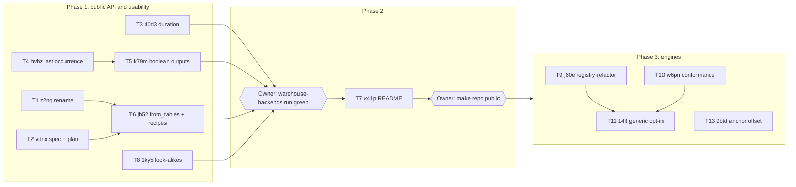

# Public Readiness Program Plan

> **For agentic workers:** REQUIRED SUB-SKILL: Use superpowers:subagent-driven-development (recommended) or superpowers:executing-plans to implement each task. Work state lives in the kata issue tree; this file is the design and sequence. Steps use checkbox (`- [ ]`) syntax for tracking.

**Goal:** Finish the breaking public-API and usability changes, rewrite the README so the owner can make the repository public, then build the engine registry for 10-15+ warehouses.

**Architecture:** A program of independent work items, each owned by one kata issue. Bounded items execute directly from their issue's acceptance list; two items (T2/T6, T9-T11) are architectural and get their own spec or implementation plan when they start. Items run in parallel lanes chosen from their file footprints; contention is resolved by sequencing inside a lane, not by fake dependencies.

**Tech Stack:** Python 3.13/3.14, Ibis, DuckDB 1.5.6 reference backend, PostgreSQL/BigQuery/Snowflake live probes, pytest tiers per `AGENTS.md`.

**Spec:** No single spec. Sources are the kata issue bodies named per task (each carries its design and acceptance) and the owner decisions recorded in the scope ledger. T2 produces `docs/superpowers/specs/2026-10-26-table-first-binding-and-recipes-design.md`, which T6 implements.

## Scope ledger

| # | Capability | Source | Confirmed |
| --- | --- | --- | --- |
| 1 | Phase order: API/usability, then README, then warehouse work; repo goes public after phase 2 | Owner: "1) focus on public api / usability changes 2) update the readme 3) the the underlying warehouse stuff ... that way I can make the repo public after 2)" | Yes |
| 2 | README rewrite | Owner: "the readme is a nightmare for me" | Yes |
| 3 | Table-first binding (`Model.from_tables`) and dataset constructors in `terrine.recipes`, low-level API kept | Owner: "should we have an even simpler high level API that is just common operations over our low level API"; "I like both of these ideas!"; "I personally thought itd help users understand better instead of having to learn our unique syntax right away" | Yes |
| 4 | Rename saved-recipe family (`DatasetRecipe` -> `DatasetDefinition`, `SavedPlanRecipe` -> `SavedPlan`) to free "recipe" | Owner: "i like this" (reply to the rename proposal); "I dont think we need pantry" | Yes |
| 5 | `TimeToEvent.duration` as elapsed time; `EventAnchor` offset for landmarking | Owner: "great! make kata issues for both" | Yes |
| 6 | `event_time(occurrence="last")`; predicates as feature/outcome values; both in phase 1 | Owner: "should we come up to solutions for these now?"; "ok can you make a plan for this?" (reply to "If you agree, I'll move k79m and hvhz to priority 1") | Yes |
| 7a | Engine registry and conformance suite for 10-15+ engines | Owner: "assume we'll support 10-15 in the near future and might expand further beyond that"; "yes please!" | Yes |
| 7b | Opt-in generic default for unregistered Ibis backends | Owner: "isnt it as easy as seeing which ibis backend is provided and giving a warning?"; "does your proposed solution have a default operation, ie just default unverified ibis?"; "yes please!" | Yes |
| 7c | Adding new engines (Trino, ClickHouse, SQL Server, Oracle, Spark, ...) | Owner: "we wont add additional engines as part of this work" | **Out of scope** - no tasks; kata `6dmp` stays in the backlog outside this plan |
| 8 | Refuse PostgreSQL-wire look-alikes (Redshift etc. admitted as PostgreSQL); moved before publication | Owner standing rule (global AGENTS.md): "Do not defer related defects found while working". Placement in phase 1 is provisional (plan review, high finding) | Yes (placement provisional; see Open decisions) |
| 9 | `from_catalog` accepts a mapping; examples import public modules only (kata `tcv2`) | Agent-proposed | **No** - no tasks; listed in the needs-human issue |
| 10 | Readable, consistent completeness columns across shapes (kata `12j7`) | Agent-proposed | **No** - no tasks; listed in the needs-human issue |

Making the repository public, choosing version/license and any push or publish are owner actions (kata `v9yy`), not tasks.

## Global Constraints

- Follow repository `AGENTS.md`: tests in the cheapest tier; red-first evidence for every new test; no wording/wiring tests; `make check TESTS="<affected paths>"` before each commit.
- Public API changes update production callers, exports, docstrings, guides, examples, fixtures and CHANGELOG in the same change; clean cutover, no aliases.
- Refusals keep stable package-wide codes; renamed codes get a breaking CHANGELOG entry; every new refusal survives pickle and deepcopy.
- Null versus zero and per-cell null reasons survive Arrow, manifests and exports unchanged.
- Package version stays `0.1.0.dev0`; no tag, push, publish or GitHub mutation (session runs with GitHub publishing disabled; owner-reserved).
- One worktree and branch per task under `.worktrees/<branch-leaf>`, based on the current `main`; merge to `main` locally after the task's review gate.
- No tooling names (kata, roborev, superpowers, subagent) in code, commits, docs or CHANGELOG.
- Warehouse parity evidence: each task touching compiled output (T3, T4, T5, T8) closes with local PostgreSQL probes, plus local BigQuery probes when `gcloud` credentials are available. Snowflake has no local credentials: before T7 starts, the owner pushes `main` and dispatches `warehouse-backends` with `backend_mode=all`; a green run is the phase 1 exit gate.

## Review Focus

1. A definition or saved plan written before T1 (old field names such as `dataset_recipe_json`, `recipe_hash`) loaded after T1 refuses with `terrine.dataset.invalid_definition` / `terrine.runtime.saved_plan_mismatch`; it never partially decodes. Detection relies on the existing strict unknown-field rejection, not on legacy-name constants. Owner: T1.
2. `occurrence="last"` over a complete lookback with no matching event yields null with `complete=True`, distinct from an incomplete lookback (null, reason). Owner: T4.
3. A boolean outcome whose condition is already met inside a window that is not yet complete yields null with a reason, never `True`. Owner: T5.
4. `Model.from_tables` keeps roster units with zero events (rows of zeros) and refuses a missing completeness declaration instead of inferring it from the latest event. Owner: T6.
5. `from_tables` generated metric names colliding with each other or with an explicit catalog name refuse with a coded error; recipes constructors never default a row-defining argument (unit, start event, period, horizon). Owner: T6.

---

## Sequence and lanes

| Wave | Parallel lanes | Why this split |
| --- | --- | --- |
| 1 | T1, T2, T3, T4 | Disjoint footprints. T1 and T3 both touch `terrine/frame.py` in different functions (recipe/view references vs `_normalize_output`); merge whichever finishes second with a rebase. T2 is documentation only |
| 2 | T5 (after T4), T6 (after T1 + T2), T8 | T4 and T5 share `spec/expressions.py`, `spec/validate.py`, `compile/columns.py`, so they run in one lane. T6 touches `model.py`, `__init__.py` and a new `recipes` module; T1 must land first so "recipe" is free. T8 touches only `execution/_postgres.py` and its tests |
| Gate | Owner pushes `main` and dispatches `warehouse-backends` (`backend_mode=all`) | Snowflake parity has no local route; GitHub actions are owner-reserved |
| 3 | T7 | Shows the final API: blocked by T3, T4, T5, T6 |
| Gate | Owner decides publication (`v9yy`) | Owner-reserved |
| 4 | T9, T10, T13 | T9 is a pure refactor of `terrine/backends/` and `terrine/execution/`; T10 adds tests only; T13 touches `compile/anchors.py` near the engine list T9 removes (`anchors.py:154`): rebase whichever lands second |
| 5 | T11 (after T9 + T10) | Needs the registry and the suite |
| - | No new engines | Owner decision; T12 removed |

Concurrency cap: at most four worktrees at once; waves 1 and 2 stay within it.

## Per-task execution protocol

Every task follows the same loop (kata-driven-development "Per-Task Discipline"):

- [ ] `kata show <ref>`; `kata claim <ref>`; comment `Approach:` before code.
- [ ] Create worktree `.worktrees/<leaf>` on branch `<branch>` from `main`.
- [ ] Red: write the failing test(s) the issue acceptance names; run and record the failure.
- [ ] Green: implement; run `make check TESTS="<paths>"` and the named integration/probe commands.
- [ ] Commit (jargon check on the staged diff); run the repository-wide review inventory; resolve owned findings.
- [ ] Merge to `main`; close the issue with `--commit <sha>` and `--evidence "test:<cmd>"`.
- [ ] Any divergence from this plan or the issue: `Divergence:` comment first.

---

### Task 1: Rename the saved-recipe family (kata `z2nq`)

**Path:** bounded, mechanical. **Branch:** `feat/saved-definitions`.

**Files:** `terrine/spec/dataset.py`, `terrine/spec/__init__.py`, `terrine/spec/transforms.py`, `terrine/runtime/recipe.py` (rename module to `terrine/runtime/saved_plan.py`), `terrine/runtime/{api,planning,__init__}.py`, `terrine/dataset/{manifest,reference,transforms}.py`, `terrine/agent/{recipes,schemas,tools}.py` (`recipes.py` -> `definitions.py`), `terrine/frame.py`, `terrine/__init__.py`, refusal registry and `docs/reference/refusals.md`, guides (`ml-staging`, `materialization-runtime`, `orchestrators`, `dataset-agent-tools`, `public-api`), examples, tests, CHANGELOG.

**Interfaces:**
- Produces: `DatasetDefinition`, `DatasetDefinitionStore`, `DatasetDefinitionReference` (`terrine.spec.dataset`); `SavedPlan` (`terrine.runtime.saved_plan`); codes `terrine.dataset.invalid_definition`, `terrine.runtime.saved_plan_mismatch`; wire fields `dataset_definition_json`, `plan_hash`; agent tools `get_dataset_definition_schema`, `propose_definition`, `validate_definition`.

- [ ] **Red:** `test_definition_json_with_legacy_recipe_fields_refuses` in `tests/dataset/test_recipe.py` (renamed to `tests/dataset/test_definition.py`): a definition or manifest written with the old field names raises `TerrineError` with code `terrine.dataset.invalid_definition` (Review Focus 1).
- [ ] **Green:** rename; `grep -rniE 'recipe' terrine` matches nothing (the `terrine.recipes` module does not exist yet; no legacy-name constants are needed because unknown fields already refuse). Previously saved artifacts are not migrated (pre-release); they refuse.
- [ ] **Verify:** `make check TESTS="tests"`; `uv run pytest -q integration`; `uv run python examples/dataset_agent_tools.py`; `uv run python examples/materialization_runtime.py`; `uv run python examples/retention_and_winsorization.py`.

### Task 2: Spec and implementation plan for `from_tables` and `terrine.recipes` (kata `vdnx`)

**Path:** architectural, documentation only. **Branch:** `docs/recipes-spec`.

**Files:** create `docs/superpowers/specs/2026-10-26-table-first-binding-and-recipes-design.md` and `docs/superpowers/plans/<date>-table-first-binding-and-recipes.md`.

**Interfaces:**
- Produces for T6: the spec settles (a) `Model.from_tables` signature and the `Events` description type, (b) generated metric naming and collision refusal code, (c) each constructor's signature with required versus defaulted arguments, (d) the AGENTS.md "Public API and refusals" wording for the two layers.

- [ ] Write the spec from the `vdnx` issue body (rules already decided: constructors return plain `Design`; low-level API unchanged including `Sequential`/`EventPanel`; roster and completeness explicit; conditional events stay a documented expression pattern).
- [ ] Self-review the spec; run the plan review on spec and plan; revise.
- [ ] Bootstrap T6's sub-tasks as children of `jb52` from the reviewed plan.

### Task 3: `TimeToEvent.duration` as elapsed time (kata `40d3`)

**Path:** bounded. **Branch:** `fix/tte-elapsed-duration`.

**Files:** `terrine/compile/shapes/time_to_event.py:479,501,512`, `terrine/frame.py:888-901`, `terrine/compile/shapes/life_table.py:53-61`, `terrine/export/lifelines.py:89-96,181-207`, tests in `tests/compile/test_time_to_event.py`, `tests/export/test_lifelines.py`, `integration/compile/test_time_to_event.py`, `integration/handoffs/test_lifelines.py`, `docs/guides/trajectories-survival.md`, CHANGELOG.

**Interfaces:**
- Produces: `duration` column of Arrow type `duration("us")` equal to terminal time minus `t0`; LifeTable and lifelines consume it directly.

- [ ] **Red:** `test_duration_is_elapsed_from_t0_for_event_and_censored_rows`: event at `t0 + 10d` gives `timedelta(days=10)`; censored at cutoff `t0 + 21d` gives `timedelta(days=21)`. `test_duration_with_delayed_entry_is_measured_from_t0`: entry at `t0 + 2d`, event at `t0 + 10d` gives `duration = 10d`, `entry_time` stays the entry timestamp, and the lifelines export's entry is `2d`.
- [ ] **Green:** emit `terminal - t0`; LifeTable and lifelines read elapsed values; KM/Cox inputs and LifeTable bins unchanged numerically.
- [ ] **Verify:** `make check TESTS="tests/compile/test_time_to_event.py tests/export/test_lifelines.py"`; `uv run pytest -q integration/compile/test_time_to_event.py integration/handoffs/test_lifelines.py`; `make test-postgres` against the scratch server.

### Task 4: `event_time(occurrence="last")` (kata `hvhz`)

**Path:** bounded. **Branch:** `feat/event-time-last`.

**Files:** `terrine/spec/expressions.py:213-220`, `terrine/compile/columns.py:470-482`, `terrine/agent/design_schema.py`, `terrine/temporal/first.py:242` (decide `last_event_value`: expose as `last_value` or delete), `docs/guides/temporal-engine.md`, tests in `tests/spec/`, `tests/compile/`, `integration/compile/`.

**Interfaces:**
- Produces: `EventTime.occurrence` accepts `"last"`; ordering is the reverse of `(timestamp, event id)`.

- [ ] **Red:** `test_last_occurrence_selects_latest_event_before_t0` (two events at `t0-5d`, `t0-1d` -> `t0-1d`); `test_last_occurrence_empty_complete_lookback_is_null_complete` (Review Focus 2); `test_last_occurrence_ties_mirror_first` (equal timestamps, event ids `a`,`b`: first -> `a`, last -> `b`).
- [ ] **Green:** accept `"last"`; reverse the ranking order; update the agent design schema enum.
- [ ] **Verify:** `make check TESTS="tests/spec tests/compile/test_columns.py"`; related integration module; `make test-postgres`.

### Task 5: Predicates as feature and outcome values (kata `k79m`)

**Path:** bounded (extends the existing eligibility compiler). **Branch:** `feat/boolean-outputs`. **After:** T4 (shared files).

**Files:** `terrine/spec/design.py:85-87,110-112`, `terrine/spec/validate.py`, `terrine/compile/_predicates.py:44-108` (role parameter instead of hard-coded `"eligibility"` at line 107), `terrine/compile/columns.py`, `docs/guides/design-specs.md`, tests.

**Interfaces:**
- Consumes: T4's `occurrence` handling (none directly; shared files only).
- Produces: `Design(features=..., outcomes=...)` accept `Gt | Eq | IsNull | And`; boolean output columns with `ColumnMeta` role `feature`/`outcome`.

- [ ] **Red:** `test_converted_within_7d_true_false_and_unknown` (event day 3 -> True; none in complete window -> False; event day 1 in incomplete window -> null with reason, Review Focus 3); `test_churned_30d_eq_zero`; `test_predicate_outcome_round_trips_json`.
- [ ] **Green:** widen accepted types; compile predicate values per role; validation reuses per-leaf role checks.
- [ ] **Verify:** `make check TESTS="tests/spec tests/compile"`; `uv run pytest -q integration/compile`; `make test-postgres`; check `frame.training_set(label=...)` accepts a boolean label.

### Task 6: Implement `Model.from_tables` and `terrine.recipes` (kata `jb52`)

**Path:** executes T2's implementation plan (sub-tasks become children of `jb52`). **Branch:** `feat/recipes`. **After:** T1, T2.

**Files (expected; T2's plan is authoritative):** `terrine/model.py`, new `terrine/recipes.py`, `terrine/__init__.py`, `docs/guides/*` (constructor first, "under the hood" Design second), examples, `AGENTS.md` (two-layer API wording), CHANGELOG.

- [ ] Execute T2's plan; Review Focus 4 and 5 tests live there.
- [ ] **Verify:** every new example runs in CI; `from_tables` produces rows identical to the equivalent hand-written Catalog for count, sum and mean metrics (integration composition).

### Task 7: README rewrite (kata `x41p`)

**Path:** bounded documentation. **Branch:** `docs/readme`. **After:** T3, T4, T5, T6.

**Files:** `README.md`, `CONTRIBUTING.md` (receives contributor/test-tier prose), guides receiving moved sections (`materialization-runtime.md`, `dataset-agent-tools.md`, `orchestrators.md`, owned-inputs section), `examples/first_dataset.py` (extractor heading).

- [ ] Rewrite to the outline in `x41p`: two-sentence purpose with an output table; 15-line example with `from_tables` + `tr.recipes`; "Datasets you can build"; five rules; warehouse table; links; contributing pointer. Add the "common feature patterns" snippets section (rolling windows, conditional event, active-before eligibility, attributes at t0, recency via `occurrence="last"`, `converted_7d`/`churned_30d` labels). Unless `12j7` is confirmed and merged first, the example output selects user-facing columns explicitly (internal `__terrine_value_*` bookkeeping stays out of the shown table) and one sentence says where per-value completeness lives.
- [ ] **Verify:** `uv run python examples/first_dataset.py`; every section removed from the README exists in a linked guide (checked by hand against the old README headings).

### Owner gate: publication

Owner chooses version and license and authorizes making the repository public (kata `v9yy`). No task runs this.

### Task 8: Refuse PostgreSQL-wire look-alikes (kata `1ky5`)

**Path:** bounded. **Branch:** `fix/postgres-identity`. **Phase:** 1, wave 2 (provisional; see Open decisions).

- [ ] **Red:** `test_server_identity_classification` on real `version()` strings: PostgreSQL 16 admitted; Redshift, Greenplum, CockroachDB refused with `terrine.backend.capability_unavailable`.
- [ ] **Green:** check identity at admission in `terrine/execution/_postgres.py`, before schema access.
- [ ] **Verify:** `make check TESTS="tests/execution"`; `make test-postgres`.

### Task 9: Dialect classes and one engine registry (kata `j60e`)

**Path:** architectural refactor; write its implementation plan when started (64 engine checks across 8 files plus the 5 engine lists listed in the issue). Behavior is unchanged except one documented user-visible change: refusal `route` text is derived from the registry (fixes the stale "DuckDB or PostgreSQL" route; CHANGELOG entry). **Branch:** `refactor/engine-registry`.

- [ ] Plan, review, bootstrap sub-tasks under `j60e`; move T8's server-identity classifier into `Engine.identify` and delete the original so exactly one classifier remains; verify with unit + integration tiers, `make test-postgres`, and an owner-dispatched `warehouse-backends` run.

### Task 10: Engine conformance suite (kata `w6pn`)

**Path:** bounded, tests only. **Branch:** `test/engine-conformance`.

- [ ] One known-answer case per regression in the issue; each shown red on a deliberate one-line break of its helper; DuckDB and PostgreSQL on every push.

### Task 11: Generic dialect and `allow_unverified` opt-in (kata `14ff`)

**Path:** architectural; short spec from the `7zj3` parent design, then plan. **After:** T9, T10. **Branch:** `feat/generic-backend`.

### Task 12: removed

Adding engines is out of scope for this plan (owner: "we wont add additional engines as part of this work"). The registry, conformance suite and generic opt-in (T9-T11) make a later engine a single dialect file plus a CI job; kata `6dmp` holds that backlog.

### Task 13: `EventAnchor` offset for landmark datasets (kata `9btd`)

**Path:** architectural-light; settle the issue's open decisions in a short design before code. Serialization stays compatible: `offset` is emitted only when nonzero, so existing saved Designs and their `spec_hash` values are unchanged; CHANGELOG entry. **Branch:** `feat/anchor-offset`. Runs in wave 4.

## Open decisions

- T8 placement: moved before publication (phase 1, wave 2) because the plan review rated shipping the look-alike gap publicly as high severity and the owner's standing rule says not to defer related defects. The owner ordered warehouse work third; T8 is a defect fix rather than warehouse feature work. Revert to phase 3 if the owner prefers.
- Unconfirmed rows 9 and 10 (kata `tcv2`, `12j7`) await the owner; the needs-human issue lists them. If confirmed, `12j7` belongs after T3 and T5 (it renames columns those tasks touch) and before T7.
- Plan review finding "allow a README milestone on the current API before T6" was rejected: the owner ordered API changes before the README ("1) focus on public api / usability changes 2) update the readme").
